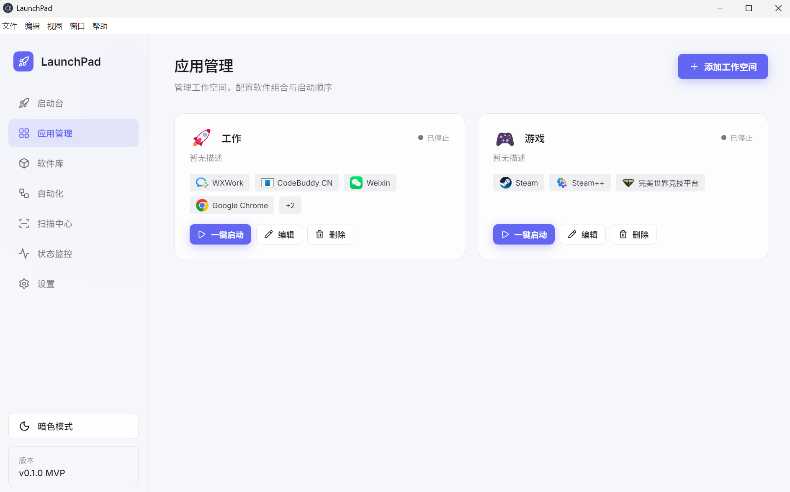
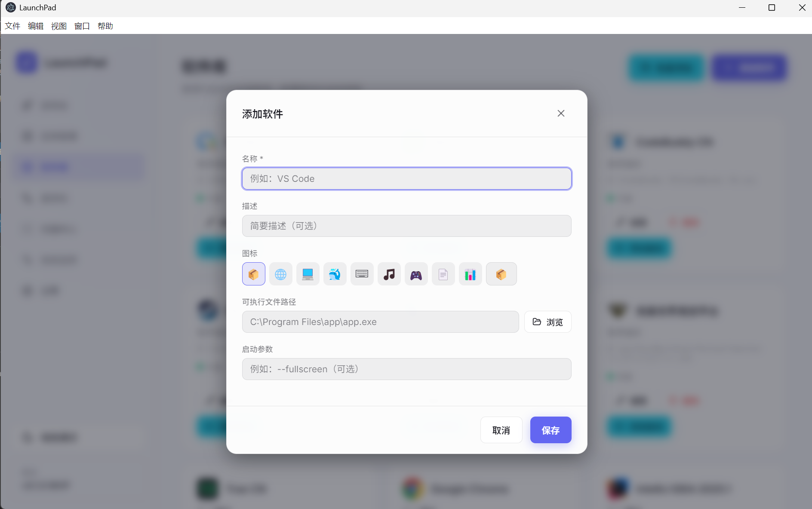
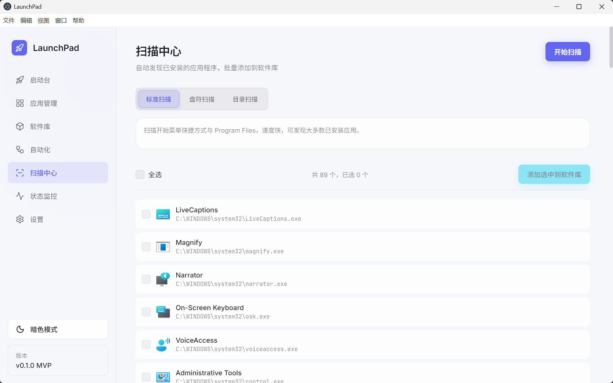
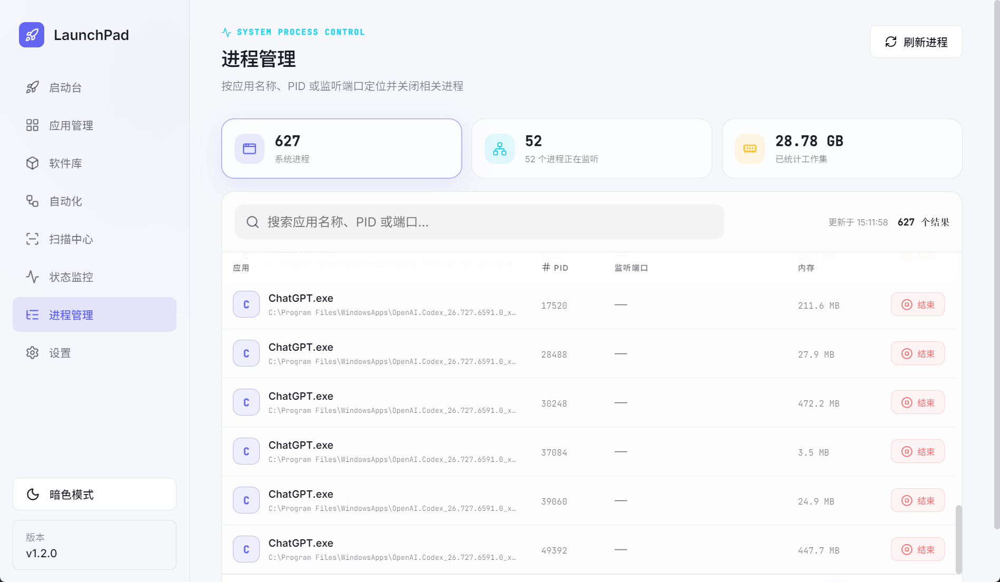
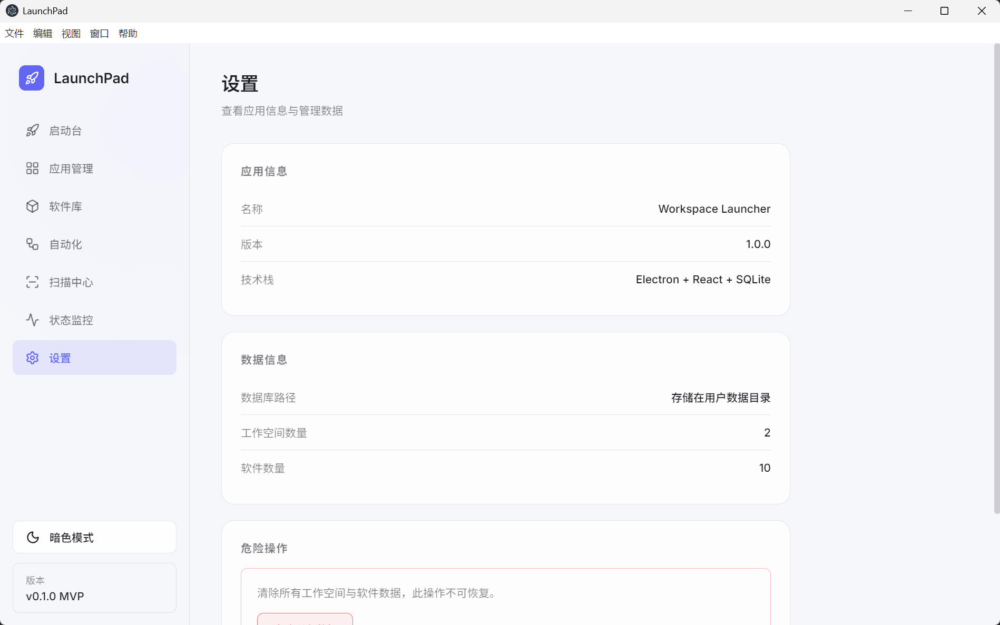

<div align="center">

[简体中文](README.md) | [English](README.en-US.md) | [日本語](README.ja-JP.md)

# LaunchPad

### 一键进入工作状态，也让一只 AI 桌宠陪你完成它

面向 Windows 的开源工作空间启动器与工作陪伴工具。
批量启动应用、管理进程与自动化任务，并通过可导入的动态桌宠获得轻量 AI 对话陪伴。

[](https://github.com/MewzCC/workspace-launcher/releases/latest)
[](https://github.com/MewzCC/workspace-launcher/releases)
[](LICENSE)
[](https://github.com/MewzCC/workspace-launcher/releases/latest)

[下载最新版](https://github.com/MewzCC/workspace-launcher/releases/latest) ·
[查看功能](#核心能力) ·
[桌宠模型导入](#导入-codex-桌宠模型) ·
[本地开发](#本地开发) ·
[反馈问题](https://github.com/MewzCC/workspace-launcher/issues)

**当前文档：简体中文｜应用界面：简体中文 · English · 日本語**

</div>



## LaunchPad 是什么？

LaunchPad 把每天重复打开的软件、脚本和工具组织成“工作空间”。设置一次启动顺序与延迟，之后只需点击一次，就能进入工作、学习、创作或游戏状态。

LaunchPad 提供独立的“桌宠工作台”：你可以拖入图片、动作帧文件夹或 ZIP 桌宠包，预览后直接使用，兼容 Codex v1/v2 图集。还可以连接自己选择的 AI 服务，让桌宠成为安静、低打扰的工作伙伴。

应用配置与工作空间数据保存在本机 SQLite 数据库中，无需注册 LaunchPad 账号。

## 核心能力

### 工作空间与效率工具

- 将多个 Windows 应用组合为工作空间并一键批量启动。
- 自定义应用启动顺序、延迟、参数和启动前后脚本。
- 在启动台查看运行状态，并一键关闭工作空间中的应用。
- 通过系统托盘驻留、开机启动和全局快捷键快速进入工作状态。
- 使用 Everything 即时搜索或扫描磁盘、目录和开始菜单中的软件。
- 管理软件库、BAT/CMD 脚本与本地自动化任务。
- 按名称、PID 或端口定位进程，查看资源占用并结束目标进程。
- 查看 CPU、内存、磁盘 I/O、网络与进程资源状态。
- 支持浅色/深色主题，以及简体中文、English、日本語三种界面语言。

### 工作陪伴型桌宠

- 独立桌宠工作台，集中管理陪伴对话、模型衣橱与桌宠设置。
- 兼容 Codex v1/v2 精灵图、参数化 SVG 与逐帧模型，支持自动识别本地素材。
- 随包提供“澜汐”等桌宠；自定义动作帧支持待机、眨眼、左右行走、招手、睡眠和拖拽等动作。
- 行为状态机统一处理单击、双击、拖拽、漫游和动画完成事件，避免动作互相覆盖。
- 情绪呈现支持本地、混合与 AI 三种模式；AI 分类失败时自动回退到本地规则。
- 支持待机、行走、工作、庆祝、休息等多种动画状态。
- 可调整桌宠大小、透明度、漫游范围、活跃程度和窗口置顶行为。
- 桌宠窗口会随模型动态调整，不用大面积透明窗口遮挡其他应用。
- 支持拖拽移动；拖拽区域跟随桌宠，不会因持续拖动不断放大窗口。
- 对话气泡自适应内容与桌面边界，避免文字被窗口裁切。
- 单击桌宠即可在下方输入消息，AI 回答继续以动态时长气泡展示；右键可启动专注计时、获取鼓励或调整桌面行为。

### 可配置 AI 对话

- 内置 OpenAI、DeepSeek、Kimi/月之暗面、智谱 GLM 厂商预设。
- 支持自定义 API 地址和模型 ID。
- 可在 Chat Completions 与 Responses API 两种接口格式中选择。
- 每个厂商可保存独立 API Key，Key 由 Electron 主进程读取并通过系统安全存储加密。
- AI 默认使用当前界面语言回答：简体中文、English 或日本語。
- 可自定义桌宠名字和性格提示，让回复方式符合自己的工作习惯。

> AI 对话请求会发送到你配置的模型服务商。请阅读对应服务商的隐私政策与计费规则，不要在对话中提交密码、令牌或其他敏感信息。

## 桌宠快速开始

1. 打开侧边栏中的“桌宠工作台”。
2. 在“模型衣橱”选择内置桌宠，或拖入素材，预览后点击“使用这个桌宠”。
3. 在“桌宠设置”调整大小、透明度、漫游与置顶行为。
4. 在 AI 设置中选择厂商、接口方式与模型，填写 API Key 后保存。
5. 回到“陪伴对话”，桌宠便会按照当前界面语言与你交流。

### 导入 Codex 桌宠模型

在“模型衣橱”把素材拖入导入区域，也可以点击“选择素材”或“选择文件夹”：**拖入素材 → 自动识别并预览 → 使用这个桌宠**。预览可切换动作、透明棋盘/深浅背景、显示大小和逐帧动画速度。只有点击“使用”后才保存到模型库并开启桌宠；源文件保持不变，重名模型保存为新副本。

支持 Live2D 完整模型包、ZIP、`pet.json`、PNG/WebP、按动作分类的帧目录。多张未分类图片按自然文件名顺序作为待机动画。单张图片可作为静态桌宠，默认关闭漫游；缺失动作会提示并使用待机画面。渲染引擎默认“自动识别”，也可手动选择“原有桌宠”或“Live2D”；选择引擎不会转换素材格式。

支持的模型格式：

| 版本 | 图集布局 | 图集尺寸 | 清单识别 |
| --- | --- | --- | --- |
| Codex v1 | 8 × 9 | 1536 × 1872 | `spriteVersionNumber: 1`，旧模型可省略该字段 |
| Codex v2 | 8 × 11 | 1536 × 2288 | `spriteVersionNumber: 2` |
| LaunchPad 逐帧 | 按动作组织图片 | 所有动作画布一致 | `schemaVersion: 1`、`renderer: "sequence"` |
| Live2D Cubism 3/4/5 | 网格模型、纹理、动作与表情 | 按模型原始比例居中 | 完整 `.model3.json` 导出包；固定 Core 5.2 |

V1/V2 模型目录至少应包含 `pet.json` 与 `spritesheet.png`/`spritesheet.webp`。逐帧素材可以不写清单，按动作组织帧文件，例如：

```text
my-pet/
├── idle/001.png、002.png …
├── walk_right/001.png、002.png …
├── walk_left/001.png、002.png …
└── drag/001.png、002.png …
```

导入器检查图片解码、帧尺寸、资源路径和压缩包大小。每动作最多 120 帧、总计 600 帧/128 MB，单张最多 16 MB。所有帧画布相同、边长不超过 4096，宽高比在 1:2 到 2:1 之间。校验失败会在导入区显示原因，模型库不会留下半成品。

Live2D 可直接拖入 `.model3.json`、完整模型目录或 ZIP，须保留 `.moc3`、纹理及配置引用的资源。多个模型会提示选择。预览提供真实动作、表情与行为映射；模型成功渲染后才能点击“使用”。未映射行为保持待机，点击使用会保存映射和缩略图并开启独立桌宠窗口。资源通过受限本地协议读取，导入素材中的 JavaScript 不会执行。

Live2D 使用 `untitled-pixi-live2d-engine` 1.4.0 + PixiJS 8.22.0，Core 5.2 本地随包提供，离线可用；Core 的授权说明见 `public/live2d/NOTICE.md` 和 `LICENSE.html`。目前不支持 Cubism 2 `.model.json`、编辑工程 `.cmo3`，以及需要更新 Core 的 moc 版本。图片或逐帧素材不会自动变成 Live2D 绑定模型。

### 自定义生成桌宠 Skill

在导入卡片点击“导出生成 Skill”，将 ZIP 中的 `create-launchpad-pet` 文件夹放入 Codex 的 `~/.codex/skills/`，在新聊天中使用：

> 用 $create-launchpad-pet 创建一只蓝色小鲸鱼，包含待机、左右行走和拖拽动作。

也可以提供参考图片。Skill 使用当前环境可用的图像生成能力制作透明角色，再通过 Python/Pillow 脚本校验、生成联系表和 ZIP 包；生成质量需要实际视觉检查。生成的 ZIP 直接拖入本应用预览即可。[Skill 源码](skills/create-launchpad-pet/SKILL.md)和[模型格式](skills/create-launchpad-pet/references/sequence-contract.md)随项目提供。

Skill 也支持整理已有 Live2D 模型，详见 [Live2D 契约](skills/create-launchpad-pet/references/live2d-contract.md)。从参考图制作 Live2D 仍需分层、绑定及 Cubism 导出，不能仅靠图片生成替代。

开发验证：`npm run test:pet-import`（旧格式导入服务），`npm run test:live2d-runtime`（真实 Live2D 模型、ZIP、引擎选择、资源隔离、安装、透明渲染和 GPU 释放），`npm run test:pet-import:ui`（生产构建、原生拖放、旧图集兼容、Live2D 预览/动作映射、桌面启用和 Skill 导出），`npm run test:pet-import:dev`（独立 Vite 开发服务器、Fast Refresh 后继续启用预览、离开页面时释放会话与资源）。设置环境变量 `LAUNCHPAD_TEST_LIVE2D_PACKAGE` 为本地模型 ZIP 路径，可同时验证该模型的预览、启用和桌面渲染。Live2D 测试首次下载固定版本的官方 Haru 样例至忽略的 output 目录，后续可复用本地文件。打包脚本可使用安装了 Pillow 的 Python 运行 `scripts/verify-pet-skill.py` 验证。

## 界面预览

### 工作空间管理

将开发、办公、创作或游戏应用按场景分组，创建自己的启动方案。


### 添加与管理软件

选择可执行文件、启动参数和图标，将常用工具集中收纳。



### 扫描中心

通过 Everything 即时查找应用，或按磁盘与目录执行可取消的扫描。



### 进程管理

按应用名称、PID 或端口定位进程，查看资源状态并结束不再需要的任务。



### 设置与本地数据

管理主题、语言、更新方式、数据路径和诊断信息。



## 下载与安装

前往 [GitHub Releases](https://github.com/MewzCC/workspace-launcher/releases/latest) 下载：

- `LaunchPad-Setup-<version>-x64.exe`：推荐，支持自选安装目录，并创建桌面与开始菜单快捷方式。
- `LaunchPad-Portable-<version>-x64.exe`：免安装便携版，下载后可直接运行。

当前版本面向 Windows 10/11 x64。项目暂未使用商业代码签名证书，Windows SmartScreen 可能显示未知发布者；请只从本仓库 Releases 页面下载。

安装版支持检查 GitHub Releases 更新。工作空间数据库和桌宠模型默认保存在本机，用户可以分别自定义数据目录与模型目录；正常升级不会清除这些数据。

## 本地开发

环境要求：Windows、Node.js 18+、npm。

```bash
git clone https://github.com/MewzCC/workspace-launcher.git
cd workspace-launcher
npm install
npm run dev
```

构建与打包：

```bash
# 构建 Electron 应用
npm run build

# 生成 Windows 安装包与便携版
npm run dist:win
```

打包产物输出到 `release/`。推送与 `package.json` 版本一致的 `v*` Tag 后，GitHub Actions 会自动构建并发布 Windows 产物。

## 技术栈

- Electron 31 + Electron Vite
- React 18 + Zustand
- SQLite + better-sqlite3
- Chart.js + Lucide React
- electron-builder + NSIS

## 数据与安全

- 工作空间、设置和桌宠配置默认保存在本机。
- API Key 不会提供给渲染页面明文读取，由 Electron 主进程使用系统安全存储加密。
- 自定义模型导入前会校验清单与精灵图，随后复制到应用管理的本地目录。
- 用户可以分别修改数据目录和模型目录。迁移采用安全复制，不覆盖目标中的已有数据，也不会自动删除原目录。
- 结束进程、关闭工作空间等操作只针对用户明确配置或选择的目标。

## 参与贡献

1. Fork 仓库并创建功能分支。
2. 提交聚焦且易于审查的改动。
3. 确认 `npm run build` 通过。
4. 发起 Pull Request，说明改动动机与验证方式。

欢迎通过 [Issues](https://github.com/MewzCC/workspace-launcher/issues) 报告问题、提出建议或补充翻译。

## 开源协议

本项目基于 [MIT License](LICENSE) 开源。

<div align="center">

如果 LaunchPad 帮你更快进入状态，欢迎点亮一个 Star。

</div>
